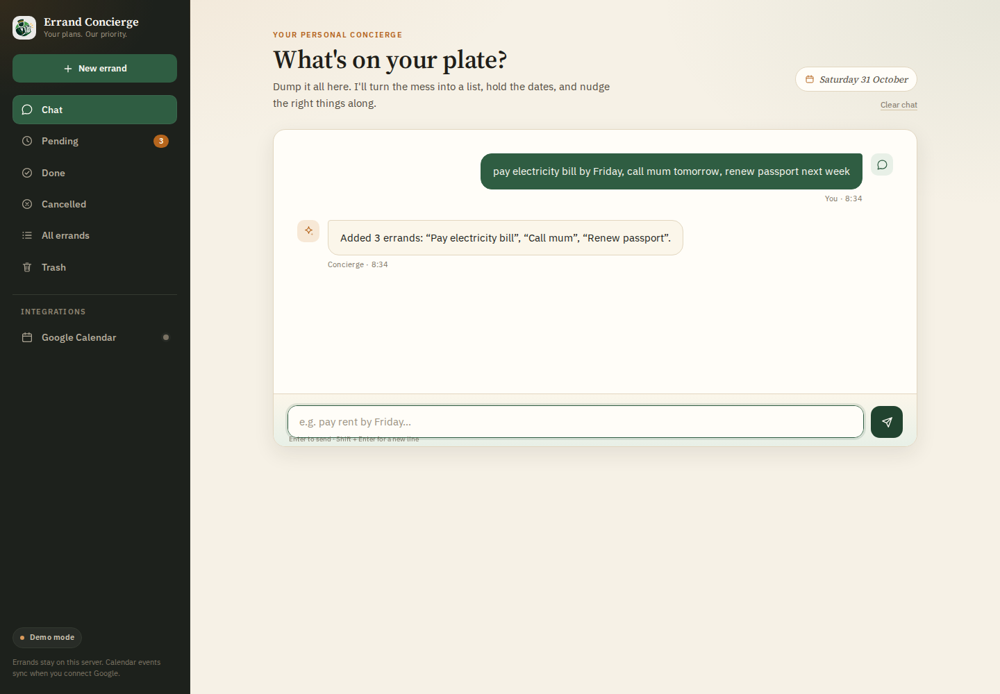
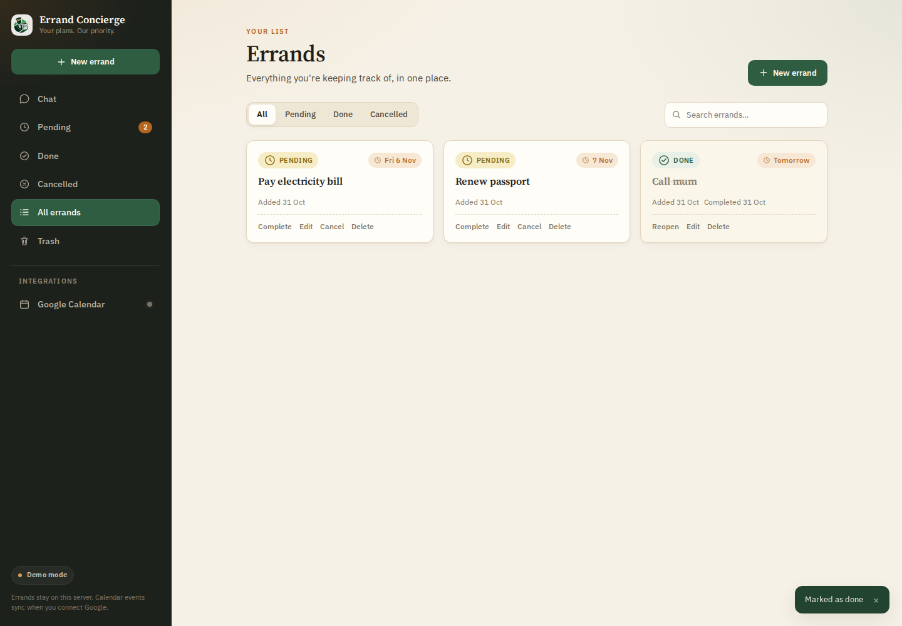
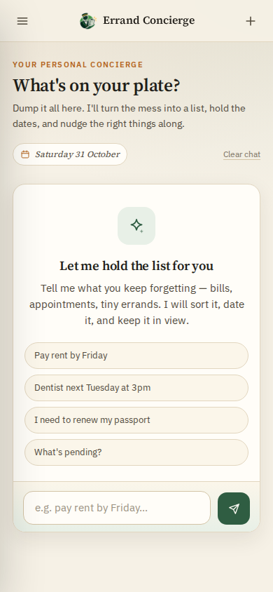

# Errand Concierge

**Your plans. Our priority.**

A conversational concierge that turns a messy brain-dump into an organized errand list — then keeps the dates, statuses, and Google Calendar in sync as life changes.

Built for the **AWS Agents for Humans Hackathon** with the [Strands Agents SDK](https://github.com/strands-agents), AWS Bedrock, FastAPI, SQLite, and a hand-built vanilla JavaScript frontend. No React, no build step, no database server.



## What it does

- **Capture in plain language.** “Pay rent by Friday, call mum tomorrow, renew my passport next week” becomes three separate errands with real due dates.
- **Reschedule conversationally.** “Push the dentist to next Tuesday at 3pm” updates the errand and its calendar event.
- **Keep a live list.** Complete, cancel, reopen, edit, delete, search, and filter — directly in the UI or through chat.
- **Undo mistakes.** Deletes go to a Trash tab with a restore action and an undo toast.
- **Sync Google Calendar.** Errands with a due date create one-hour events. Rescheduling moves them; completing, cancelling, or deleting removes them.
- **Work without a model key.** With no `BEDROCK_API_KEY`, a deterministic demo assistant runs the same tools, so the whole product is usable locally and in CI.



<p align="center">
  
</p>

## Architecture

```
Browser (vanilla JS SPA)
   │  fetch /api/*
   ▼
FastAPI (app/factory.py)
   ├── routes/         chat · errands · integrations · system
   ├── services/
   │     ├── assistant   Strands agent per session, or demo fallback
   │     ├── errands     business logic + calendar side effects
   │     ├── google_oauth    OAuth 2.0, signed state, token refresh
   │     └── google_calendar best-effort event create/update/delete
   ├── repository.py   all SQL
   ├── db.py           schema, WAL, legacy JSON migration
   └── dates.py        natural-language date parser
   │
   ├── SQLite (data/errands.db)
   └── Google Calendar API
```

### Design decisions

- **The model never does date math.** It passes the user’s phrase (“friday”, “in 3 days”) straight to `app/dates.py`, which resolves it against the real current date in the configured timezone. This kills the class of bug where an LLM confidently states the wrong weekday.
- **The model re-reads live state.** Tools query SQLite on every call. Sidebar actions bypass the chat agent, so conversation memory is never trusted for “what’s pending?”
- **Per-session agents.** Each browser session gets its own Strands `Agent` with a TTL, instead of one global singleton shared by every visitor.
- **Calendar is best-effort.** Network failures or a disconnected account never block adding, editing, or completing an errand.
- **SQLite, not a JSON file.** Concurrent request threads can’t clobber each other’s writes, and the schema is indexed.

## Quickstart

Requires **Python 3.11+**.

```bash
git clone https://github.com/normid291/errand-concierge.git
cd errand-concierge
python3 -m venv .venv
source .venv/bin/activate
pip install -r requirements-dev.txt
cp .env.example .env          # optional for demo mode
uvicorn app.main:app --reload
```

Open <http://localhost:8000>. With an empty `.env` it starts in **demo mode**: chat is handled by the built-in rule-based assistant, and every errand feature works.

Useful commands:

| Command | What it does |
|---|---|
| `make dev` | Run with auto-reload on port 8000 |
| `make test` | Run the pytest suite |
| `make lint` | Ruff |
| `python -m app.cli` | Chat from the terminal |
| `uvicorn app.main:app` | Production entry point |

The API docs are at `/api/docs`.

## Configuration

Copy `.env.example` to `.env`. Everything is optional.

| Variable | Purpose |
|---|---|
| `BEDROCK_API_KEY` | Enables the real LLM. Without it, demo mode is used. |
| `BEDROCK_BASE_URL` | OpenAI-compatible endpoint (default: Bedrock Mantle, `us-east-1`). |
| `BEDROCK_MODEL_ID` | Default `openai.gpt-oss-120b`. |
| `DEMO_MODE` | Force the demo assistant even when a key exists. |
| `DATABASE_PATH` | SQLite file, default `./data/errands.db`. |
| `APP_SECRET` | HMAC secret for OAuth state. Set in production. |
| `ALLOWED_ORIGINS` | Comma-separated CORS allow-list for a separately hosted frontend. |
| `FRONTEND_URL` | Where OAuth redirects land if the UI is on another origin. |
| `CALENDAR_TIMEZONE` | IANA timezone, default `Africa/Lagos`. |
| `GOOGLE_CLIENT_ID` / `GOOGLE_CLIENT_SECRET` | Enables the Calendar integration. |
| `GOOGLE_REDIRECT_URI` | Must exactly match the Google Cloud Console redirect URI. |
| `SESSION_TTL_HOURS` / `MAX_SESSIONS` | In-memory chat session limits. |

### Google Calendar setup

1. Create a project in [Google Cloud Console](https://console.cloud.google.com/) and enable the **Google Calendar API**.
2. Create an **OAuth 2.0 Client ID** of type *Web application*.
3. Add the redirect URI exactly: `http://localhost:8000/api/integrations/google/callback` (and your production URL).
4. Add your Google account as a **Test user** on the OAuth consent screen.
5. Put the client ID and secret in `.env`.

The app requests only `calendar.events` plus basic profile scope, stores one token set in SQLite, and refreshes it automatically. Disconnecting revokes the token with Google.

## API

| Method | Path | Purpose |
|---|---|---|
| `GET` | `/api/health` | Liveness, version, assistant mode |
| `GET` | `/api/config` | Public runtime configuration |
| `GET` | `/api/stats` | Counts, due today, overdue |
| `POST` | `/api/chat` | `{message, session_id?}` → `{reply, session_id, mode}` |
| `DELETE` | `/api/chat/{session_id}` | Forget a conversation |
| `GET` | `/api/errands?status=&q=` | List / search |
| `POST` | `/api/errands` | Create `{title, due?, notes?}` |
| `GET` | `/api/errands/{id}` | Fetch one |
| `PATCH` | `/api/errands/{id}` | Update title, due, or notes |
| `DELETE` | `/api/errands/{id}` | Move to trash |
| `POST` | `/api/errands/{id}/complete` | Mark done |
| `POST` | `/api/errands/{id}/cancel` | Cancel |
| `POST` | `/api/errands/{id}/reopen` | Return to pending |
| `GET` | `/api/errands/trash` | Deleted errands |
| `POST` | `/api/errands/trash/{id}/restore` | Restore |
| `DELETE` | `/api/errands/trash/{id}` | Delete permanently |
| `POST` | `/api/errands/trash/clear` | Empty the trash |
| `GET` | `/api/integrations/google/status` | Connection + email |
| `GET` | `/api/integrations/google/connect` | Start OAuth |
| `GET` | `/api/integrations/google/callback` | OAuth callback |
| `POST` | `/api/integrations/google/disconnect` | Revoke and forget |

## Project layout

```
app/
├── main.py              ASGI entry point
├── factory.py           app factory and dependency wiring
├── config.py            env-backed settings
├── db.py                schema, connection helpers, legacy migration
├── repository.py        SQL for errands and trash
├── dates.py             plain-language date parsing
├── schemas.py           Pydantic HTTP models
├── cli.py               terminal client
├── routes/              chat, errands, integrations, system
└── services/
    ├── assistant.py     Strands agent + demo fallback + system prompt
    ├── errands.py       business logic and calendar sync
    ├── google_oauth.py  OAuth flow, signed state, token storage
    └── google_calendar.py

frontend/
├── index.html           single-page shell
├── styles.css           design system and responsive layouts
├── app.js               hash routing, chat, errands, dialogs, toasts
├── config.js            optional API base override
└── assets/              logo files

tests/                   date parser, API, storage, static serving
```

The old JSON files (`tasks.json`, `tasks_trash.json`) are imported automatically on first startup if the database is empty, then renamed to `*.migrated`.

## Testing

```bash
pip install -r requirements-dev.txt
pytest
```

The suite uses a temporary SQLite database and the demo assistant, so it needs no credentials or network. It covers date parsing, CRUD/status transitions, search escaping, trash/restore, stats, chat flows, validation, and static serving.

## Deployment

The app is one service: FastAPI serves the API **and** the frontend. That removes the old two-host setup and its CORS/rewrite failure modes.

**Docker**

```bash
docker build -t errand-concierge .
docker run --rm -p 8000:8000 --env-file .env errand-concierge
```

**Railway** — `railway.json` sets the start command and health check. Add `BEDROCK_API_KEY`, `APP_SECRET`, and optionally the Google variables. Attach a volume at `/app/data` if you want SQLite to survive redeploys; otherwise the filesystem is ephemeral.

**Vercel (optional, UI only)** — if you keep hosting `frontend/` separately, set `frontend/config.js` to your backend URL (or define `window.ERRAND_CONCIERGE_API` before it loads) and set `ALLOWED_ORIGINS` plus `FRONTEND_URL` on the backend. Hosting the frontend from FastAPI is recommended.

`backend.py` remains as a compatibility shim for deployments whose start command is still `python backend.py`.

## Known limitations

- **Single-user by design.** There are no accounts. One deployment has one errand list and one connected Google account.
- **No authentication.** Anyone with the URL can read and modify the list. Put the app behind a private network, a reverse-proxy password, or an auth layer before using it with real data.
- **Chat memory is in-process.** Restarting the server starts fresh conversations, though errands persist in SQLite.
- **Calendar events are one hour long** and use `CALENDAR_TIMEZONE`; all-day events are not modelled.
- **Demo mode is not an LLM.** It handles add/list/reschedule/complete/cancel with simple patterns, which is enough to exercise the product but not to hold a general conversation.
- **The model endpoint is configurable, not portable.** The default is Bedrock Mantle’s OpenAI-compatible API; any OpenAI-compatible endpoint works via `BEDROCK_BASE_URL`.

## License

No license has been added yet. Until one is, the code is “all rights reserved” by default — add an MIT or Apache-2.0 `LICENSE` file if you want others to reuse it.
